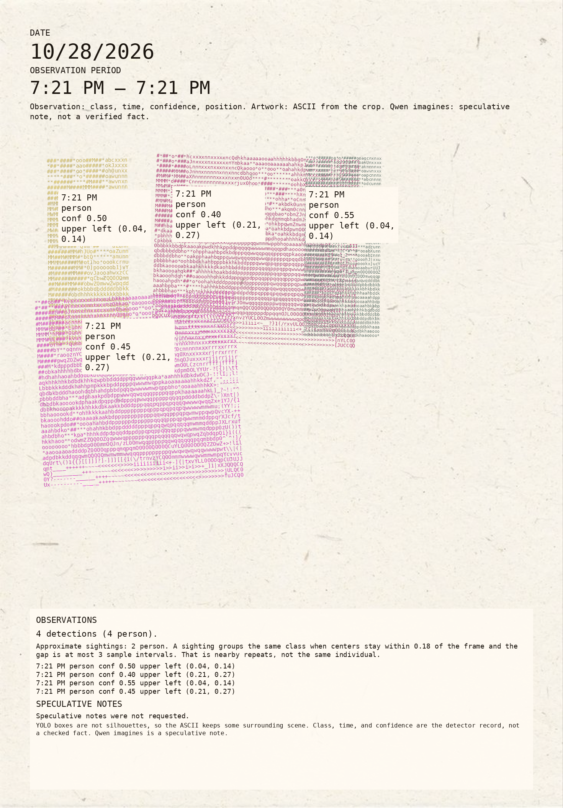
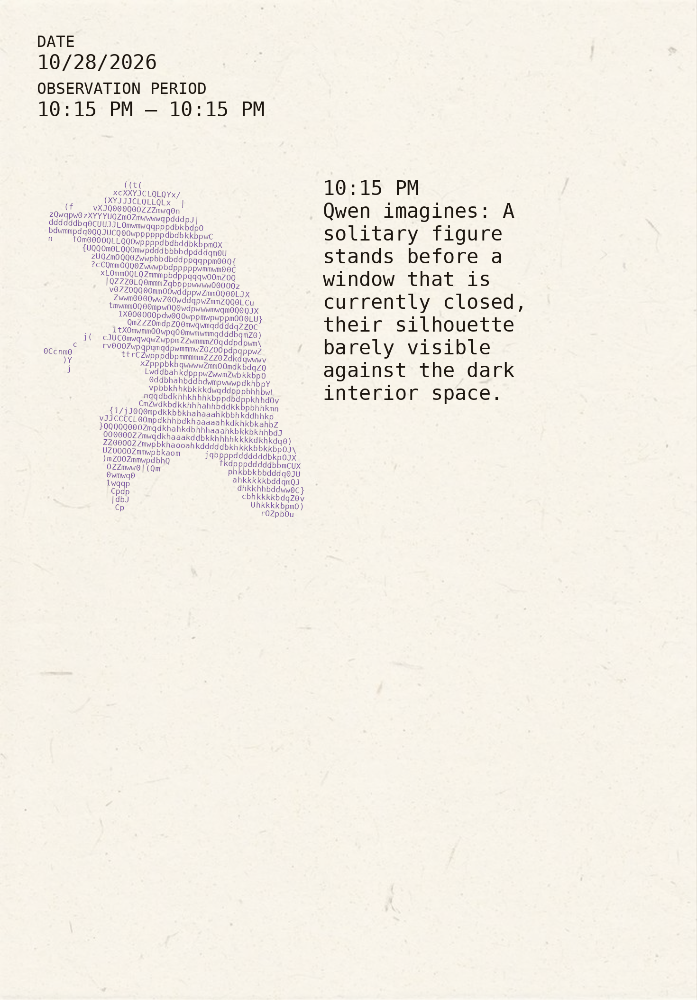
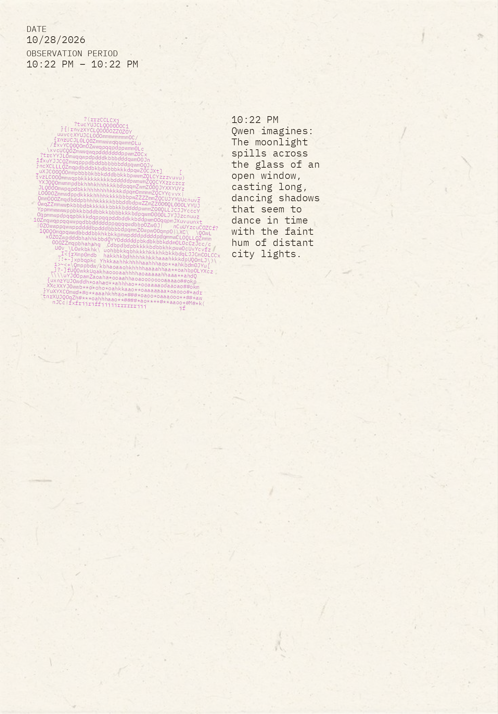
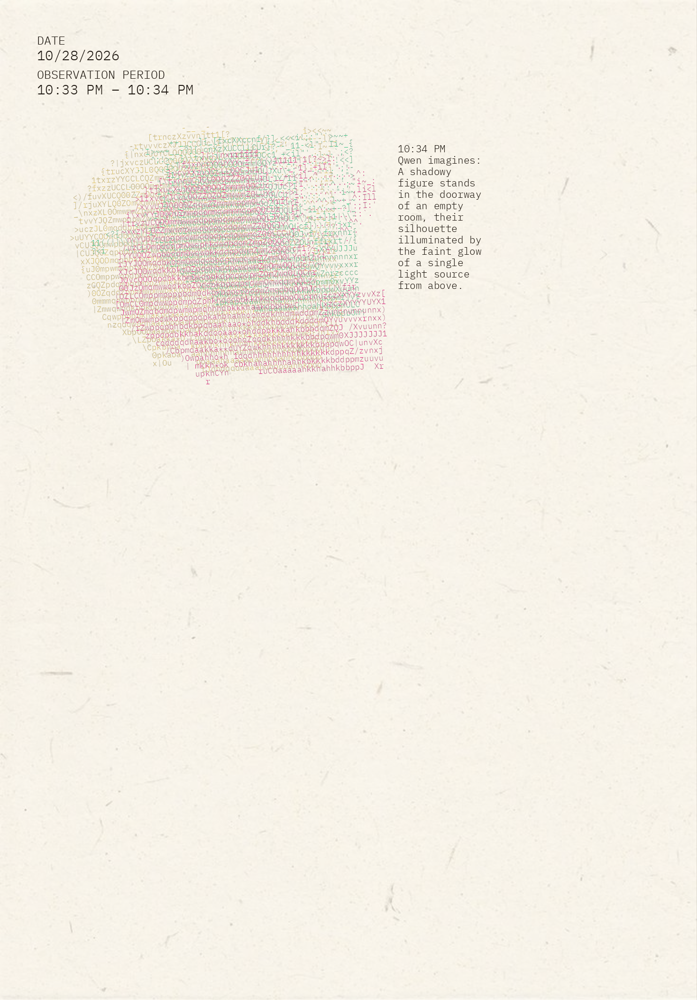
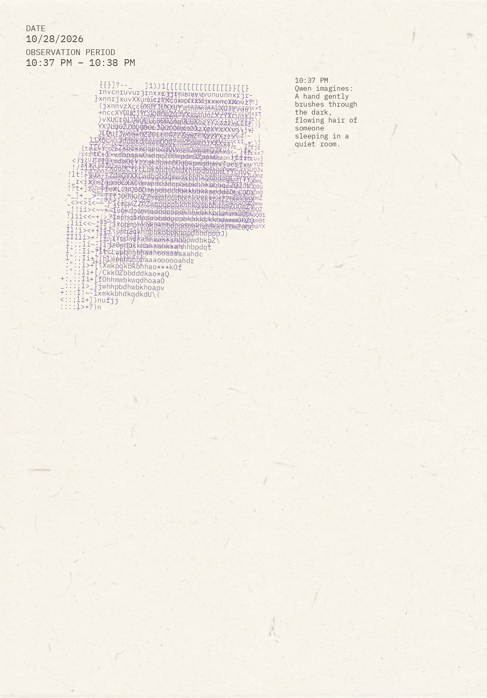
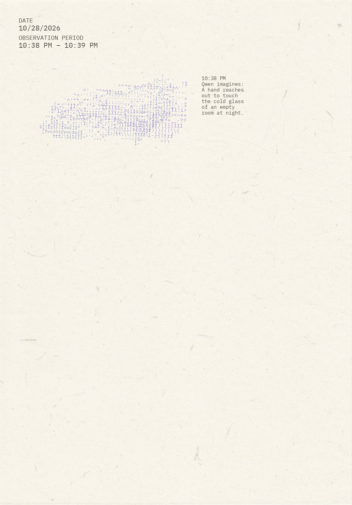
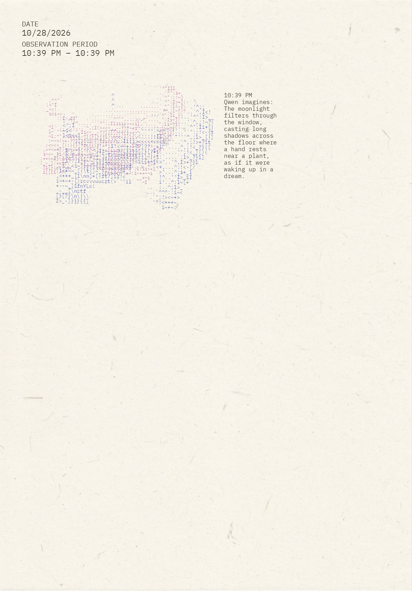
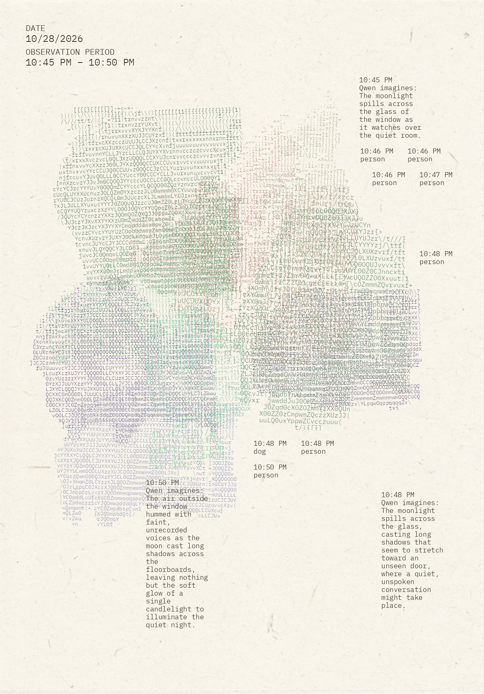
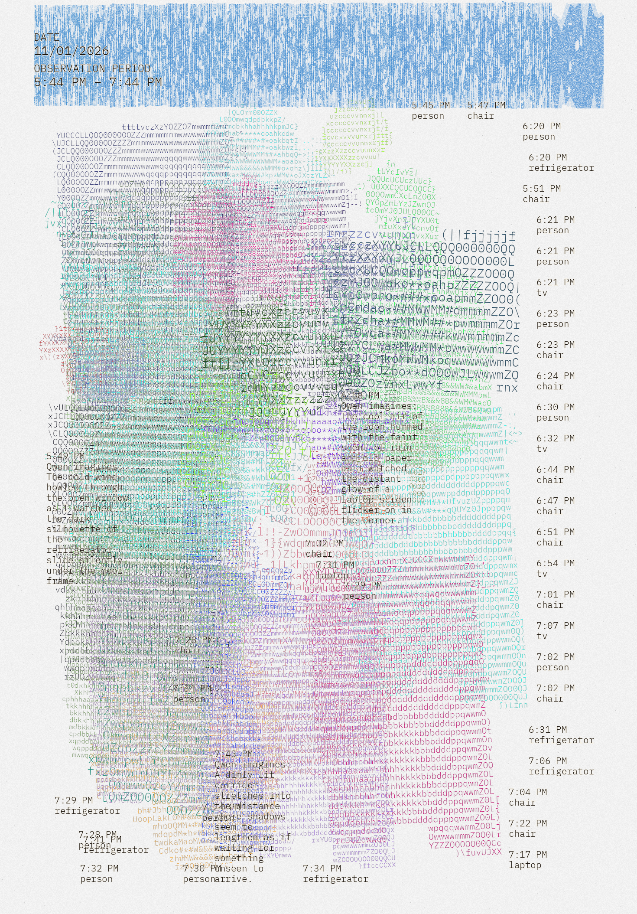
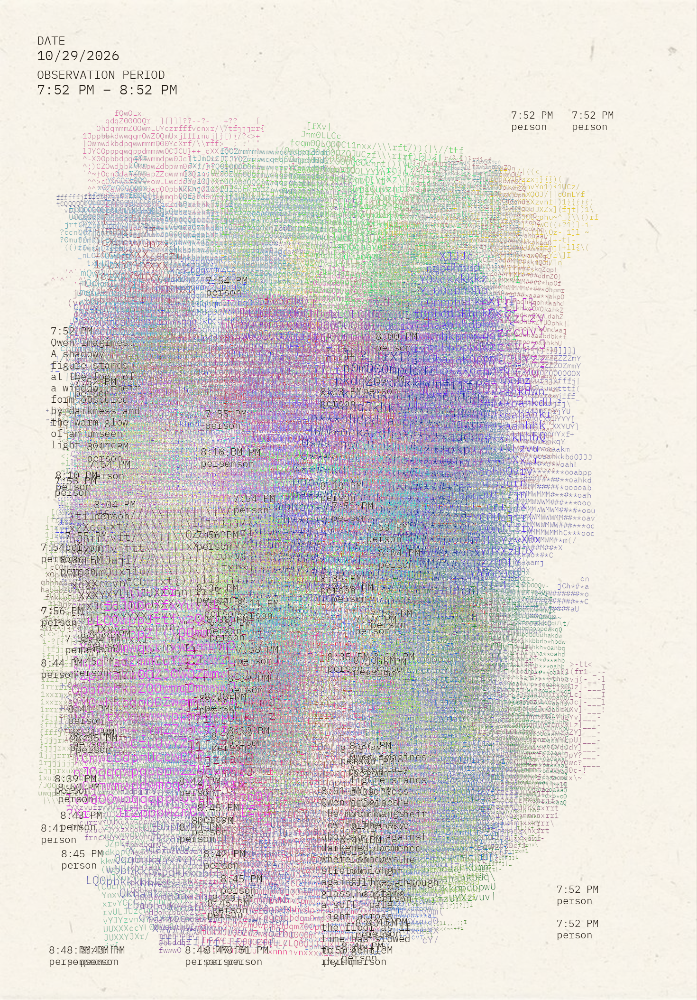

# Poetic Surveillance

Poetic Surveillance asks how a machine interprets a human life. A camera at a window samples still frames. A detector finds objects, pulls each one off the background, and redraws it as colored ASCII on paper. Local Qwen then writes a short line about the crop. That line is a guess. The postcard is the machine's reading of the hour, not a record of what the hour was.

## Part 2

### Mockup

The mockup sets out three ways the same watch could look. The left sheet separates figures and gives each one a time and a line. The middle sheet lets many frames pile up until the people, animals, and objects become one field. The right sheet leaves a figure inside a night photograph. The built cards follow the first two. The night photograph is the case the detector cannot yet make.


### First observations, without a humidity sensor

[`night_window.py`](night_window.py) is the watch with no DHT11. It samples the camera, isolates each detected object, and writes one `morning_postcard.png` when the period ends. These October 28 cards are that version. The first still prints confidence and position. The later ones keep a time and, when Ollama answered, a line that begins `Qwen imagines:`.

<p>
  
  
  
  
</p>
<p>
  
  
  
  
</p>

### Humidity as a stamp

[`night_window_temp.py`](../night_window_temp.py) is the same watch with a DHT11 on GPIO D4, read once at each sample. Temperature chooses the color of a stamped band across the card, from violet near 15°C through blue, green, and yellow to red near 40°C. Humidity sets the height of that band. The ink is broken on purpose: uneven pressure, holes, and streaks, so the reading looks pressed into the paper rather than drawn as a chart.

This is that card, November 1, 5:46 PM to 7:46 PM. The blue stamp is the temperature and humidity for the watch. The pile underneath is person, chair, refrigerator, tv, and laptop.



### Final postcard

This card is one hour, 7:52 PM to 8:52 PM on October 29. Repeated frames of the same nearby figure are stacked in different colors, so an hour of one place becomes a single pile. Times and Qwen lines sit in the margins.



### From a box to ASCII

YOLO26n returns a rectangle and a class name. The rectangle is not a silhouette. Before any character is drawn, the crop is cut down to a foreground mask. The normal path is OpenCV GrabCut inside the padded box. A mask that still fills the box is rejected, and that crop is left off the card. The pixels that remain are turned into ASCII: denser, darker characters where the crop is darker, empty space where the background was. Nearby repeats of the same class share one caption and are drawn on top of each other, slightly shifted, up to six frames.

### What Qwen is shown

After the camera stops, a few isolated crops are sent to local Qwen (`qwen3.5:0.8b` through Ollama on this machine). Each request carries the crop image and the detector's metadata: class, time, confidence, and rough position. The prompt asks for one imaginative sentence and forbids treating that sentence as a fact, or guessing who someone is. The postcard prints the reply as `Qwen imagines:`. `--qwen-cap` limits how many crops are sent, because each image call is slow. If Ollama is down, the card is still written and the caption falls back to the class name.

### Limit

The postcard is a poor night observer. Object detection fails in the dark, so the mask cannot subtract the background and there is nothing solid to redraw as ASCII. The cards in this folder were made in daylight and in well-lit rooms.

## Run

Run these commands from `Lab 5/poetic surveillance`, in the Lab 5 virtualenv. Get consent from everyone in the household. Point the camera away from beds and away from neighboring windows.

```bash
cd "Lab 5"
source .venv/bin/activate
cd "poetic surveillance"
python night_window.py observe --duration 300 --headless
```

`night_window.py` is the watch without the DHT11. Use `night_window_temp.py` from the `Lab 5` folder only when that sensor is connected. A plain SSH session stops when the laptop closes. Leave a long watch under `nohup` and read `nohup.out` later:

```bash
nohup python night_window.py observe --duration 28800 --interval 20 --qwen-cap 3 > night.log 2>&1 &
```

The detector is `yolo26n_ncnn_model` in the parent `Lab 5` folder. Qwen is optional: `ollama pull qwen3.5:0.8b`. Pass `--skip-qwen` when Ollama is down. Each session folder keeps only `morning_postcard.png`.
