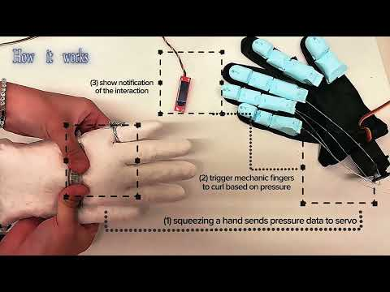
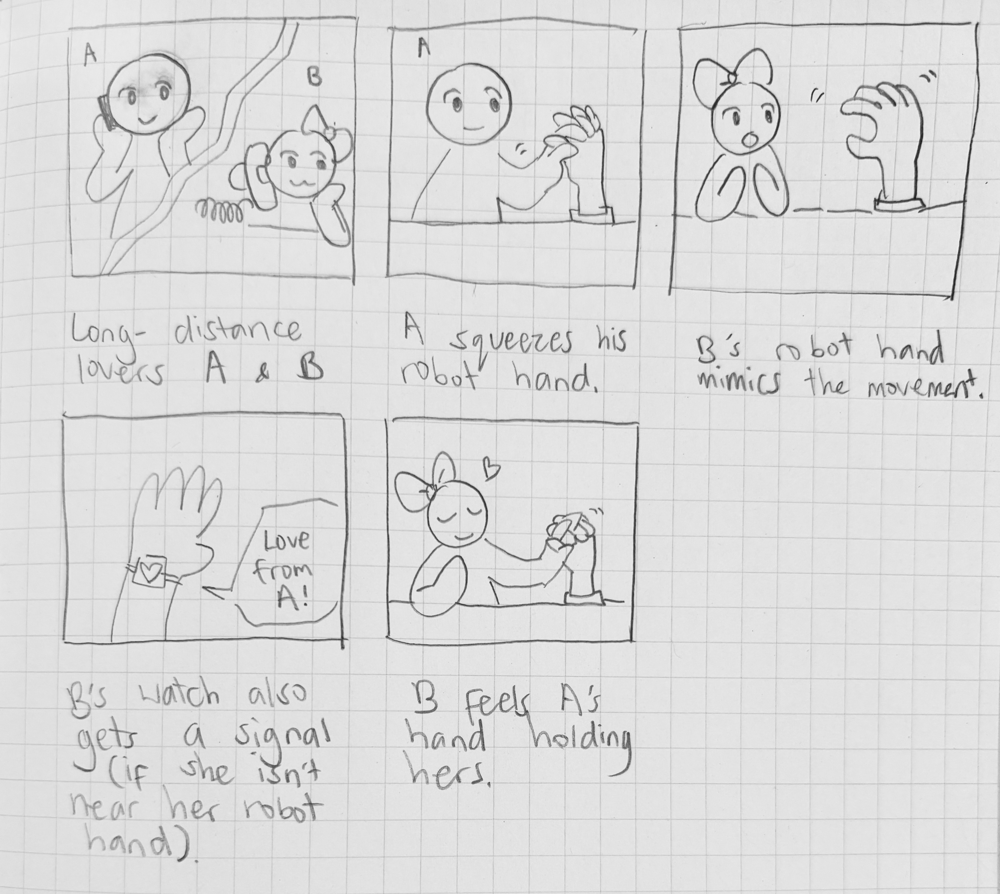
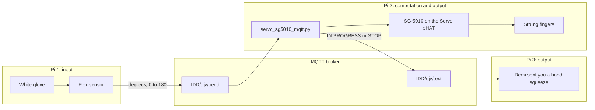

# TeleAbsence

**Team:** Jaclyn Pham, Demi Hu, Vasudha Devkota

**Members:** Jaclyn Pham (cqp4), Demi Hu (dh785), Vasudha Devkota (vd269)

[](https://www.youtube.com/watch?v=xix3lFBBjuw)

[Watch the finished piece](https://www.youtube.com/watch?v=xix3lFBBjuw)

## The piece

TeleAbsence lets two people share a touch when they are not in the same place. One person squeezes a soft glove. A bend sensor on that glove reads how far the hand closes and sends the number to a second Raspberry Pi. A servo on that Pi pulls strings in another hand, and those fingers curl into a squeeze. A third Pi shows the receiver a note: "Demi sent you a hand squeeze."

The squeeze matches the bend. The glove sends a number from 0 to 180. The other hand turns to that same angle. A small bend makes a small curl. A deep bend pulls the strings as far as the servo can go. Letting go sends 0, the strings loosen, and the hand opens. Any number above 0 makes the servo Pi send `IN PROGRESS` on `IDD/djv/text`. A 0 sends `STOP`. Pi 3 listens to that channel. While the message is `IN PROGRESS`, its screen tells the receiver, "Demi sent you a hand squeeze." `STOP` clears the note. The broker keeps the latest message, so the screen is still right if Pi 3 connects late.

The idea comes from [TeleAbsence](https://tangible.media.mit.edu/project/teleabsence/) at the MIT Tangible Media Group: two people share a gesture when they cannot be in the same room. The hands are a [Flexy Hand](https://youtu.be/Z70YWNuOB8E?si=lgnRUYCbhTde_MYc). The string path through the fingers comes from [Xstrings](https://hcie.csail.mit.edu/research/xstrings/xstrings.html), MIT research on running one string through a printed part so a pull becomes a curl.

## Storyboard



A and B are far apart, still on the phone. A squeezes his robot hand. B's robot hand copies the curl. If she is away from that hand, her watch still gets a note. In the drawing it says "Love from A!" On Pi 3 the note says "Demi sent you a hand squeeze." In the last panel she feels A's hand holding hers. That last moment is the whole idea.

## Making the hand

We started with the sensing glove, then a black glove with foam on the fingertips, then the printed fingers. These clips are our own tests at the desk, in the order we filmed them.

**Bending the white glove while the reading is running.** The bend sensor sits on the back of the hand. A Pi and one loose printed finger are on the desk.

<video src="design%20progress/IMG_1210.MOV" controls width="640"></video>

**The same glove over the keyboard**, with the readings open on the screen below.

<video src="design%20progress/IMG_1211.MOV" controls width="640"></video>

**The glove sitting still.** The sensor runs down the back of the hand. The Pi is at the right edge of the frame.

<video src="design%20progress/IMG_1212.MOV" controls width="640"></video>

**Pressing the glove flat**, to watch the sensor go through a full bend.

<video src="design%20progress/IMG_1213.MOV" controls width="640"></video>

**The black glove**, with foam on the fingertips, next to a Pi. The laptop is printing the numbers.

<video src="design%20progress/IMG_1214.MOV" controls width="640"></video>

**A closer look at that glove**, with the Pi's light on.

<video src="design%20progress/IMG_1215.MOV" controls width="640"></video>

### The printed fingers

The first fingers were three separate prints, two pale and one black. Each one is a row of little blocks with a clear string through the joints. That string is the Xstrings idea. Pull it, and the finger curls.


The next fingers are smooth segments instead of a zigzag. They sit on a white glove, and the Pi is already on the table. These are Flexy Hand fingers, cut down so we could run the string ourselves.


Then we printed the palm. Yellow palm, blue fingers, holes at the joints for the string.


### The two gloves

The sending glove is white and soft. A bend sensor runs along the back of the hand, with a small board on the wires. Next to it are the printed hand, a loose SG-5010, and the string, not tied to the servo yet.


The receiving glove is black. The blue finger pieces are tied on, and clear strings run from the fingertips to one servo at the wrist. That one servo pulls every finger we strung. The white glove in front shows the bend sensor the other Pi is reading.


On the table the two hands sit apart, the way the people in the story do. The white glove and its sensor are on the left. The strung hand and the servo are on the right. Each one has its own Pi.


The sensing glove plugged into a Raspberry Pi 4. The bend sensor crosses the wrist, and the printed fingers and servo sit just behind the glove.


## Across the network

Three Pis share the class message server, `farlab.infosci.cornell.edu:1883`. Each Pi has one job.



| Pi | Role | What it touches | MQTT |
| --- | --- | --- | --- |
| 1 | Input | Soft glove and bend sensor | Sends the bend on `IDD/djv/bend` |
| 2 | Computation and output | Raspberry Pi, SparkFun Servo pHAT, SG-5010, strings through the printed fingers | Listens to `IDD/djv/bend`. Sends `IDD/djv/text` |
| 3 | Output | A screen that tells the receiver, "Demi sent you a hand squeeze" | Listens to `IDD/djv/text` |

The number on `IDD/djv/bend` is how far the servo horn should turn. `0` means open. `180` is a full turn, which is as far as this servo can pull the strings. The glove sends new numbers many times a second, faster than the servo should keep jumping, so Pi 2 uses the newest number and moves once a second.

The note is written by the servo Pi, the one actually pulling the strings. Any angle above 0 means that Pi is turning the horn. Zero means the hand went back to open and the horn was sent home. We do not have a second sensor on the receiving fingers to check that they touched a person. `IN PROGRESS` means the number arrived and the servo was told to pull. Pi 3 turns that into the line the receiver reads: "Demi sent you a hand squeeze." The broker saves the last message, so the screen still shows it if Pi 3 connects while the hand is already closed.

```120:128:Lab 6/TeleAbsence/finger_curl_mqtt.py
def status_for(degrees):
    if degrees == 0:
        return STOP
    return IN_PROGRESS


def publish_status(client, status):
    client.publish(TEXT_TOPIC, status, retain=True)
    print(f"Sent {status} on {TEXT_TOPIC}.")
```

`servo_sg5010_mqtt.py` uses that rule, and it drives the SG-5010 with a pulse of 500 µs at 0° and 2500 µs at 180°. An earlier range, 1100 to 1900 µs, stopped short of the servo's real travel, so the curl was smaller than the number we sent. There is no language model in this loop. The little rule above runs on the servo Pi every time it accepts a new number. If the note came from the glove Pi instead, it would still say `IN PROGRESS` even when this Pi was unplugged.

| Topic | Who publishes | Payload | Meaning |
| --- | --- | --- | --- |
| `IDD/djv/bend` | The glove Pi | A number from 0 to 180, such as `0.0` or `78.9` | How far the sending hand is bent |
| `IDD/djv/text` | The servo Pi | `IN PROGRESS` or `STOP` | Pi 3 shows "Demi sent you a hand squeeze" on `IN PROGRESS`, and clears it on `STOP` |

Capital letters matter. `IDD/djv/bend` is our channel. `IDD/DJV/bend` is a different channel, and it stays empty.

## What the build taught us

The person who squeezes does not see the other hand. The receiver feels the strings, and Pi 3 tells them, "Demi sent you a hand squeeze." That split is the project.

The glove sends a new angle many times a second. If we held each number for 10 seconds, we would miss the rest of the squeeze. The script that runs in the piece takes the newest angle once a second and stays there until the next one. The hand opens when the channel sends 0. The 10-second hold is only in `servo_sg5010_curl.py`, the test where someone types one number at a time.

The hardest part was getting the finger to move with the pressure. A light squeeze should make a small curl, and a firm squeeze should close the hand further. We got there by tying the string to a servo horn and turning the horn by the same number of degrees the glove sent. That works, and it is also fussy. Right now the fingers only move if we hold the pull between the fingers and the servo at an angle. The second set of fingers looks much more like a real hand, but those pieces are heavier, and they do not curl as well as the first ones.

This servo can turn about halfway around, and then it stops. It cannot wind the string for several full turns. One horn pulls every finger we tied on, so the hand closes all at once. The Servo pHAT also needs its own USB-C cable for the motor. Without that cable the board still shows up on I2C at `0x40`, and the servo does not move.

Next time we will try another material, and a different way of making the joints, so the fingers weigh less and bend more easily. We also want the string to pull on its own, without someone holding it at an angle between the fingers and the servo. The drawing says "Love from A!" Pi 3 says it in plain words: "Demi sent you a hand squeeze."

## Outside the team

One person who is not on the team tried the two hands. They said, "It's such a novel way to show intimacy."

They felt the curl as a way of being close. That is the reaction we were hoping for.

<details>
<summary>How to run it, and the files</summary>

The SG-5010 plugs into a numbered spot on the SparkFun Servo pHAT. Tell the script that number with `--channel`. It will not guess. The Pi has its own USB-C power. A second USB-C cable, plugged into the pHAT, powers the servo. Do not power the SG-5010 from a GPIO pin or the Pi's 5 V pin. If the horn buzzes because it has hit the stop, bring `--min-us` and `--max-us` closer together and stop the script.

On the servo Pi, from `Lab 6`, with `adafruit-circuitpython-servokit` and `paho-mqtt` installed:

```bash
cd "Lab 6/TeleAbsence"
python servo_sg5010_mqtt.py --channel 0
```

Channel 0 is only an example. Use the number printed next to the plug you used.

To move the horn before the other Pis are connected:

```bash
python servo_sg5010_curl.py --channel 0
```

Type a number from 0 to 180. The horn holds it for 10 seconds, then returns to 0. `q` releases the pulse.

To send one test number the way the glove Pi does:

```bash
mosquitto_pub -h farlab.infosci.cornell.edu -p 1883 -t 'IDD/djv/bend' -m '45' -u idd -P 'device@theFarm'
```

`45` turns the horn to 45° and sends `IN PROGRESS`. A later `0` opens the hand and sends `STOP`. The real glove should keep sending the angle it is reading.

On the notification Pi, `IN PROGRESS` is shown to the receiver as "Demi sent you a hand squeeze." `STOP` clears it. To watch the channel itself:

```bash
mosquitto_sub -h farlab.infosci.cornell.edu -p 1883 -t 'IDD/djv/text' -u idd -P 'device@theFarm'
```

| File | What it is |
| --- | --- |
| `TeleAbsence/servo_sg5010_mqtt.py` | The script we run for the piece. It reads the bend, moves the SG-5010, and sends the note. |
| `TeleAbsence/finger_curl_mqtt.py` | The same MQTT loop, with the shorter pulse range from earlier tests. |
| `TeleAbsence/servo_sg5010_curl.py` | Type an angle from 0 to 180. It holds for 10 seconds, then goes back to 0. |
| `TeleAbsence/finger_curl.py` | An earlier typing test, from 0 to 90, starting at 45°. |
| `TeleAbsence/servo_sg5010_test.py` | Keyboard test for one plug: left, right, center, and a small sweep. |

</details>

## References

- MIT Tangible Media Group, [TeleAbsence](https://tangible.media.mit.edu/project/teleabsence/). The project we started from. Someone far away can still feel that you are there, through a gesture.
- MIT HCI Engineering, [Xstrings](https://hcie.csail.mit.edu/research/xstrings/xstrings.html). We used this for the string path in the printed fingers. One string runs through the joints, and pulling it closes the finger.
- Gyrobot, [Flexy Hand](https://youtu.be/Z70YWNuOB8E?si=lgnRUYCbhTde_MYc). The printed hand we built the fingers and palm from.
