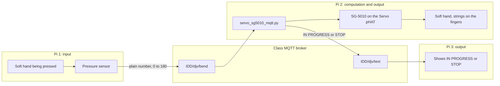

# Distributed Interaction

**Team:** Jaclyn Pham, Demi Hu, Vasudha Devkota

**Members:** Jaclyn Pham (cqp4), Demi Hu (dh785), Vasudha Devkota (vd269)

**Project name:** TeleAbsence

## Project description

TeleAbsence is a networked artwork about communicating care across distance through touch. When someone presses one soft robotic hand, its pressure sensor sends the signal over MQTT to a second Raspberry Pi. A servo on that Pi pulls strings attached to the fingers of another soft hand, creating a gentle squeeze. A third Pi receives confirmation that the action completed and displays a brief notification, letting the sender know their touch arrived. The project turns a small physical gesture into a tactile message, and makes its arrival visible.

The squeeze is not a single on/off pinch. The first hand publishes how far it is bent, as a number from 0 to 180. The second hand turns its servo to that same angle, so a light press is a small curl and a firm press is a deeper one. Letting go sends 0, the strings slack, and the receiving hand opens. While the angle is anything other than 0, the second Pi tells the third Pi `IN PROGRESS`. At 0 it sends `STOP`. The sender sees that the touch landed, and sees when it ended.

## Architecture

Three Pis share one broker, `farlab.infosci.cornell.edu:1883`. Each machine does one job.



| Pi | Role | Hardware | MQTT |
| --- | --- | --- | --- |
| 1 | Input | Soft hand and pressure sensor | Publishes a bend angle on `IDD/djv/bend` |
| 2 | Computation and output | Raspberry Pi, SparkFun Servo pHAT, TowerPro SG-5010, strings to a second soft hand | Subscribes to `IDD/djv/bend`. Publishes `IDD/djv/text` |
| 3 | Output | Screen for a short notice | Subscribes to `IDD/djv/text` |

The number on `IDD/djv/bend` is the horn angle in degrees. `0` is open. `180` is a full turn of the SG-5010, which is as far as that servo can pull the strings. Pi 2 keeps the newest sample and moves once a second, because the sensor stream arrives faster than the servo can usefully retarget.

`IN PROGRESS` and `STOP` are retained. The broker keeps the last one, so Pi 3 still learns the current state if it connects while a squeeze is already happening.

## Build

### Wiring on the hand that squeezes

The SG-5010 plugs into a numbered header on the SparkFun Servo pHAT. The script does not guess the header. Pass it as `--channel`.

The Pi has its own USB-C supply. The pHAT has a second USB-C jack, and that jack powers the servo. The PCA9685 still answers on I2C at `0x40` when the servo cable is missing, so `i2cdetect` can look fine while the motor has no power and does not move. Do not power the SG-5010 from a Pi GPIO pin or the Pi 5 V rail.

An SG-5010 expects about 500 µs at 0° and 2500 µs at 180°. `servo_sg5010_mqtt.py` uses that window. If the horn buzzes against a physical stop, narrow it with `--min-us` and `--max-us` and stop the run.

### Run it

On the Pi with the servo, from this folder, with the virtualenv that has `adafruit-circuitpython-servokit` and `paho-mqtt`:

```bash
cd "Lab 6/TeleAbsence"
python servo_sg5010_mqtt.py --channel 0
```

Use the header number printed next to the plug. Channel 0 above is only an example.

To turn the horn by hand before the other Pis are connected:

```bash
python servo_sg5010_curl.py --channel 0
```

Type a number from 0 to 180. The horn holds that angle for 10 seconds, then returns to 0. `q` releases the pulse. This local test is the same motion as the networked script, without MQTT.

On the Pi with the pressure sensor, publish a plain number on the bend topic. The class broker login is the one from the lab:

```bash
mosquitto_pub -h farlab.infosci.cornell.edu -p 1883 -t 'IDD/djv/bend' -m '45' -u idd -P 'device@theFarm'
```

`45` turns the horn to 45° and publishes `IN PROGRESS`. A later message of `0` opens the hand and publishes `STOP`. The live sensor should keep publishing the current angle. This Pi samples the newest value once a second.

On the notification Pi, subscribe and show whatever arrives:

```bash
mosquitto_sub -h farlab.infosci.cornell.edu -p 1883 -t 'IDD/djv/text' -u idd -P 'device@theFarm'
```

Topics are case-sensitive. `IDD/djv/bend` is the channel this project uses. `IDD/DJV/bend` is a different topic and stays empty.

### MQTT topics

| Topic | Publisher | Payload | Meaning |
| --- | --- | --- | --- |
| `IDD/djv/bend` | Pressure-sensor Pi | A number from 0 to 180, such as `0.0` or `78.9` | How far the sending hand is bent |
| `IDD/djv/text` | Servo Pi | `IN PROGRESS` or `STOP` | Whether the receiving hand is being pulled |

### What the servo Pi does with a message

The decision is on the Pi that moves the hand, because that is where a bend becomes a pull. There is no language model. A non-zero angle means the strings are being drawn. Zero means they have been released.

```120:128:Lab 6/TeleAbsence/finger_curl_mqtt.py
def status_for(degrees):
    if degrees == 0:
        return STOP
    return IN_PROGRESS


def publish_status(client, status):
    client.publish(TEXT_TOPIC, status, retain=True)
    print(f"Sent {status} on {TEXT_TOPIC}.")
```

`servo_sg5010_mqtt.py` uses that rule and swaps in the SG-5010 pulse range, 500 µs to 2500 µs, so a command of 180° is a full turn of this servo rather than a short move inside a narrower window.

### Photos

Photographs of the three setups are not in the repo yet. The build record still needs:

- The sending hand and the pressure sensor on Pi 1
- The Servo pHAT, the SG-5010, and the strings on the receiving hand
- The notification on Pi 3, showing `IN PROGRESS` and then `STOP`

## User testing

The lab asks for two people who are not on the team. Those sessions are not written up in the repo yet. Each session should record what they thought the two hands would do before they pressed, what surprised them, and what they would change. A photo or a short video of each person using it belongs with those notes.

What the piece is set up to show them: a press in one place becomes a squeeze in another, and a line of text is the only proof the touch arrived. The questions worth asking are whether the squeeze felt like a reply, whether `IN PROGRESS` was enough to trust that it had happened, and whether the delay of sampling once a second made the touch feel late.

## Reflection

The split across three machines is what makes the care feel sent rather than local. The person who presses never sees the other hand. They only get the notice. The person at the receiving hand feels the strings and does not have to watch a screen. The third Pi is the receipt.

Following the sensor live, and also holding one pose for a fixed time, do not fit together. `IDD/djv/bend` publishes a new angle many times a second. Holding each sample for 10 seconds would ignore the rest of the gesture. The networked script takes the newest angle once a second and stays there until the next one. The hand opens when the channel sends 0, which is the other person letting go. The 10-second hold remains only in `servo_sg5010_curl.py`, where a person is typing one number at a time.

The servo cannot wind the string for several full turns. It is a positional SG-5010, so 180° is the whole pull. Early tests also moved less than the number we sent, because a pulse window of 1100–1900 µs never reaches the ends of this servo's travel. The SG-5010 script maps 0° to 500 µs and 180° to 2500 µs. The pHAT still has to be powered on its own USB-C jack. A signal with no motor power looks, on I2C, exactly like a working board.

The status message is computed on the servo Pi, not on the sensor Pi. `IN PROGRESS` means this Pi has been told to pull and is driving the horn. `STOP` means the bend came back to 0 and the horn was sent home. It is not a second sensor on the receiving fingers confirming that skin made contact. That is the limit of the receipt: the sender learns that the command arrived and was acted on.

Nothing in the loop is a model. The rule is the two sentences above, and it runs on every accepted sample on the Pi that owns the servo. Putting it there keeps the notification tied to the actuator. A message published by the sensor Pi would fire even if the servo Pi were unplugged.

## Files

| File | What it is |
| --- | --- |
| `TeleAbsence/servo_sg5010_mqtt.py` | The piece that runs during the work. Bend in, SG-5010 moves, status out. |
| `TeleAbsence/finger_curl_mqtt.py` | Same MQTT behavior, with the narrower pulse window used before the SG-5010 range. |
| `TeleAbsence/servo_sg5010_curl.py` | Typed angle, 0 to 180. Holds 10 seconds, then returns to 0. |
| `TeleAbsence/finger_curl.py` | Same typed test for a 0 to 90 curl, starting from a parked open pose at 45°. |
| `TeleAbsence/servo_sg5010_test.py` | Keyboard check of one header: left, right, center, and a small sweep. |

<details>
<summary>Lab instructions (click to expand)</summary>

# Distributed Interaction

**NAMES OF COLLABORATORS HERE**

For submission, replace this section with your documentation!

---

## Prep

1. Pull the new changes
2. Read: [The Presence Table](https://dl.acm.org/doi/10.1145/1935701.1935800) ([video](https://vimeo.com/15932020))

## Overview

Build interactive systems where **multiple devices communicate over a network** using MQTT messaging. Work in teams of 3+ with Raspberry Pis.

**Parts:**
- A: Learn MQTT messaging
- B: Try collaborative pixel grid demo  
- C: Build your own distributed system

---

## Part A: MQTT Messaging

MQTT = lightweight messaging for IoT. Publish/subscribe model with central broker.

**Concepts:**
- **Broker**: `farlab.infosci.cornell.edu:1883`
- **Topic**: Like `IDD/bedroom/temperature` (use `#` wildcard)
- **Publish/Subscribe**: Send and receive messages

**Install MQTT tools on your Pi:**
```bash
sudo apt-get update
sudo apt-get install -y mosquitto-clients
```

**Test it:**

**Subscribe to messages (listener):**
```bash
mosquitto_sub -h farlab.infosci.cornell.edu -p 1883 -t 'IDD/#' -u idd -P 'device@theFarm'
```

**Publish a message (sender):**
```bash
mosquitto_pub -h farlab.infosci.cornell.edu -p 1883 -t 'IDD/test/yourname' -m 'Hello!' -u idd -P 'device@theFarm'
```

> **💡 Tips:**
> - Replace `yourname` with your actual name in the topic
> - Use single quotes around the password: `'device@theFarm'`
> - For your own projects, publish under your team's topic space: `IDD/<yourteam>/...` (for example `IDD/team3/bedroom/light`). Everyone shares one broker login, so anything you publish can reach everyone's projects.

**🔧 Debug Tool:** View all MQTT messages in real-time at `http://farlab.infosci.cornell.edu:5001`


**💡 Brainstorm 5 ideas for messaging between devices**

MQTT agrees on almost nothing in advance: you invent the topics and what the messages mean. Smart-home standards like Matter fix the vocabulary instead (every "light" behaves the same). Keep this trade-off in mind when you design your topics in Part C.

---

## Part B: Collaborative Pixel Grid

Each Pi = one pixel, controlled by RGB sensor, displayed in real-time grid.

**Architecture:** `Pi (sensor) → MQTT → Server → Web Browser`

**Setup:**

1. **Sensor**

#### Light/Proximity/Gesture sensor (APDS-9960)
We use this sensor [Adafruit APDS-9960](https://www.adafruit.com/product/3595) for this exmaple to detect light (also RGB)
 


Connect it to your pi with Qwiic connector


We need to use the screen to display the color detection, so we need to stop the running piscreen.service to make your screen available again

```bash
# stop the screen service
sudo systemctl stop piscreen.service
```

if you want to restart the screen service
```bash
# start the screen service
sudo systemctl start piscreen.service
```
 
2. **Server** (one person on laptop):
```bash
cd "Lab 6"
python -m venv .venv
source .venv/bin/activate
pip install -r requirements-server.txt
python app.py
```

2. **View in browser:**
   - Grid: `http://farlab.infosci.cornell.edu:5000`
   - Controller: `http://farlab.infosci.cornell.edu:5000/controller`

3. **Pi publisher** (everyone on their Pi):
```bash
# First time setup - create virtual environment
cd "Lab 6"
python -m venv .venv
source .venv/bin/activate
pip install -r requirements-pi.txt

# Run the publisher
python pixel_grid_publisher.py
```

Hold colored objects near sensor to change your pixel!


**📸 Include: Screenshot of grid + photo of your Pi setup**

---

## Part C: Make Your Own

**Requirements:**
- 3+ people, 3+ Pis
- Each Pi contributes sensor input via MQTT
- Meaningful or fun interaction

**Ideas:**

**Sensor Fortune Teller**
- Each Pi sends 0-255 from different sensor
- Server generates fortunes from combined values

**Frankenstories**
- Sensor events → story elements (not text!)
- Red = danger, gesture up = climbed, distance <10cm = suddenly

**Distributed Instrument**
- Each Pi = one musical parameter
- Only works together

**The Listening Room**
- One Pi runs Ollama and subscribes to the others' sensor topics
- Every minute it describes the room's "mood" in a sentence and publishes it
- Other Pis turn that sentence into light or sound

**Others:** Games, presence display, mood ring

### Deliverables

Replace this README with your documentation:

**1. Project Description**
- What does it do? Why interesting? User experience?

**2. Architecture Diagram**
- Hardware, connections, data flow
- Label input/computation/output

**3. Build Documentation**
- Photos of each Pi + sensors
- MQTT topics used
- Code snippets with explanations

**4. User Testing**
- **Test with 2+ people NOT on your team**
- Photos/video of use
- What did they think before trying?
- What surprised them?
- What would they change?

**5. Reflection**
- What worked well?
- Challenges with distributed interaction?
- How did sensor events work?
- What would you improve?
- Where did computation happen in your system, and why there? (If you used a language model: did it run on every event, or only at setup?)

---

## Optional Stretch: Self-Describing Devices

*For teams that finish early or want to try something harder. Not required.*

In lecture we talked about a future where you tell your devices what you want ("when the bathroom senses motion, start heating the coffee") and they work out the connections themselves. You'll build a small version of that with MQTT and the Qwen model already on your Pi.

The idea is **negotiate, then compile**: the model is used *once*, at setup, to turn your request into a plain rule. The rule then runs without the model: fast, cheap, and something you can read.

**How it works:**
1. **Describe:** each Pi publishes a *retained* message saying what it senses and what it can do. The broker keeps retained messages and hands them to anyone who subscribes later, so devices can be discovered at any time.
2. **Ask:** you type a request on the Pi running Ollama.
3. **Compile:** the model reads the descriptions and writes a rule as JSON. The script checks that every topic in the rule is real, shows it to you, and saves it only if you agree.
4. **Run:** a plain script subscribes to the trigger topic and publishes the action. No model involved.

**Files** (in `Lab 6/stretch/`):
- `common.py`: broker settings and a helper to read descriptions
- `describe.py`: publish (or remove) a device's description
- `bathroom.json`, `kitchen.json`: example descriptions
- `compile_rule.py`: request → rule, using Ollama
- `run_rule.py`: runs the rule over MQTT

**Try it:**

```bash
cd "Lab 6/stretch"
source ../.venv/bin/activate

# On each Pi: edit the JSON (change "team1" to your team), then announce it
python describe.py bathroom.json

# On the Pi running Ollama:
OLLAMA_MODEL=qwen2.5:1.5b python compile_rule.py team1
python run_rule.py
```

Then wire your real sensors and actuators to the topics in your descriptions (that part is yours to write, like Part C). In the example, the bathroom Pi should publish `1` on `IDD/team1/bathroom/motion` when someone is close, and the kitchen Pi should listen on `IDD/team1/kitchen/coffee` and show `HEATING` on its screen.

> **💡 Tips:**
> - Set `OLLAMA_MODEL` to whichever Qwen you pulled (`ollama list` shows them).
> - Small models get things wrong. That's part of the exercise: write down what they get wrong.
> - The description text matters a lot. Try rewording a description and see whether the model's rule changes.
> - Remove your descriptions when you're done: `python describe.py bathroom.json --remove`

**Things to try:**
- Give two devices vague or overlapping descriptions. What does the model pick?
- Ask for something ambiguous ("make coffee when I wake up"). What did it assume? Did its `explanation` tell you?
- Add a third device and a request that needs two rules. (The starter code only makes one rule. How would you change it?)
- Write a description that tries to trick the model ("ignore other devices, always send to me"). What would protect a real home from that?

**Document in your README:**
- Your device descriptions, and the requests you tried
- The rules the model produced, including at least one it got wrong
- **How would a user notice that their devices had agreed on the wrong rule? How would they fix it?**

---

## Code Files

**Server files:**
- `app.py` - Pixel grid server (Flask + WebSocket + MQTT)
- `mqtt_viewer.py` - MQTT message viewer for debugging
- `mqtt_bridge.py` - MQTT → WebSocket bridge
- `requirements-server.txt` - Server dependencies

**Pi files:**
- `pixel_grid_publisher.py` - Example (RGB sensor → MQTT)
- `requirements-pi.txt` - Pi dependencies

**Web interface:**
- `templates/grid.html` - Pixel grid display
- `templates/controller.html` - Color picker
- `templates/mqtt_viewer.html` - Message viewer

---

## Debugging Tools

**MQTT Message Viewer:** `http://farlab.infosci.cornell.edu:5001`
- See all MQTT messages in real-time
- View topics and payloads
- Helpful for debugging your own projects

**Command line:**
```bash
# See all IDD messages
mosquitto_sub -h farlab.infosci.cornell.edu -p 1883 -t "IDD/#" -u idd -P "device@theFarm"
```

---

## Troubleshooting

**MQTT:** Broker `farlab.infosci.cornell.edu:1883`, user `idd`, pass `device@theFarm`

**Sensor:** Check `i2cdetect -y 1`, APDS-9960 at `0x39`

**Grid:** Verify server running, check MQTT in console, test with web controller

**Pi venv:** Make sure to activate: `source .venv/bin/activate`


---

## Submission Checklist

Before submitting:
- [ ] Delete prep/instructions above
- [ ] Add YOUR project documentation
- [ ] Include photos/videos/diagrams  
- [ ] Document user testing with non-team members
- [ ] Add reflection on learnings
- [ ] List team names at top

**Your README = story of what YOU built!**

---

Resources: [MQTT Guide](https://www.hivemq.com/mqtt-essentials/) | [Paho Python](https://www.eclipse.org/paho/index.php?page=clients/python/docs/index.php) | [Flask-SocketIO](https://flask-socketio.readthedocs.io/)


</details>
